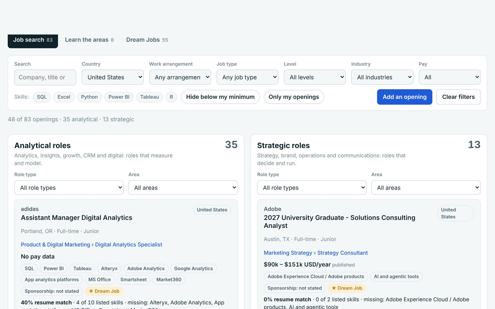
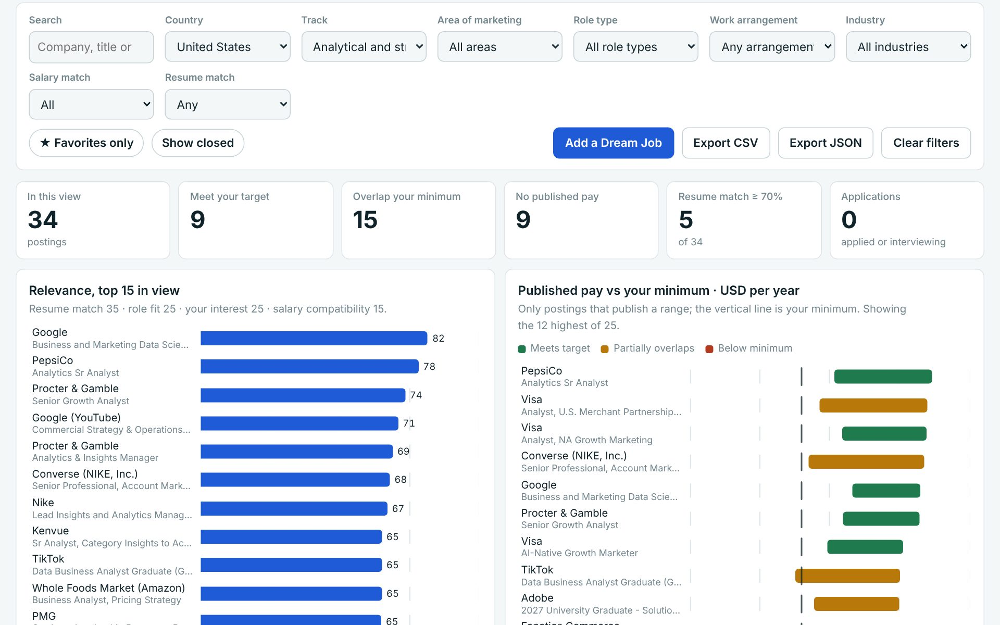
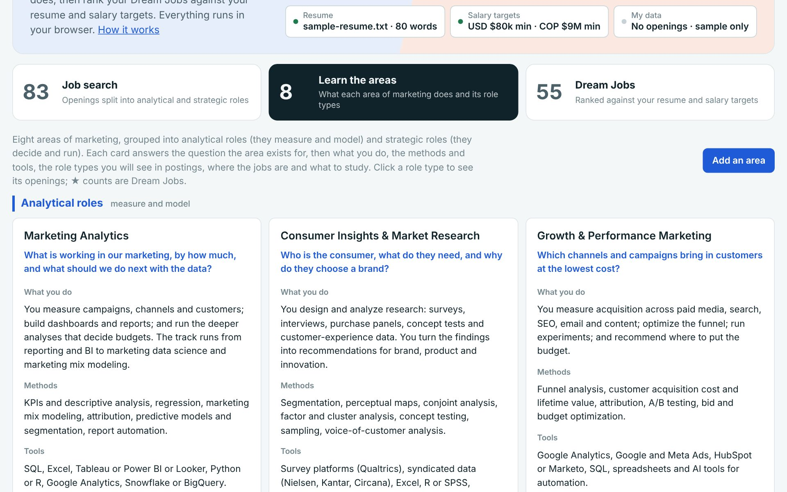

<div align="center">

# María Serrano

**Analytics marketer.** MS in Marketing (analytics track) at UT Austin McCombs · Junior Marketing Director at Óberon TSI, Bogotá

*"I market the way I swim: with heart, and by the numbers."*

[**Marketing Job Search Finder (live)**](https://mariaserrano01.github.io/digitalportfolio/job-search-finder/) · [**mariaserrano.co**](https://mariaserrano.co) · [**LinkedIn**](https://www.linkedin.com/in/maria-camila-serrano-lopez/)

</div>

---

## 1 · Marketing Job Search Finder

[](https://mariaserrano01.github.io/digitalportfolio/job-search-finder/)

A single-page tool that answers one question for marketing job seekers: *which openings deserve my time?* Pick any country (United States first) and the screen splits into **analytical roles** (analytics, insights, growth, CRM, digital) and **strategic roles** (strategy, brand, operations, communications), each filtered by role type, work arrangement, job type, level, industry and pay.

| Section | What it does |
|---|---|
| **Job search** | 83 real openings in the United States and Colombia, explained card by card: what the job is, where it sits in marketing, requirements, what to study, how to approach it. |
| **Learn the areas** | The eight areas of marketing, grouped into analytical and strategic: the question each area answers, methods, tools, role types, where the jobs are, what to study. |
| **Dream Jobs** | A shortlist ranked 0–100 by resume match (35), role fit (25), the viewer's interest (25) and salary compatibility (15), with favorites, statuses, notes and CSV/JSON export. |

Anyone can bring their own profile: upload a resume (PDF, Word or text) for a keyword match against every posting, set salary targets per currency, add openings in any country, promote any opening to Dream Jobs and export the data. Everything runs in the browser; nothing is uploaded anywhere.

**Grounded in the MS in Marketing curriculum.** The role taxonomy, the "What to study" note on every opening, the "Master's courses that prepare you" list on every area and Dream Job, and the role-fit rating were written from the published curriculum of the UT Austin McCombs MS in Marketing, core and electives alike: Marketing Management, Financial Management, Statistics for Marketing, Marketing Analytics I–III, Data Analysis, Data Analytics & Dynamic Pricing, Brand & Growth Strategy, Design Thinking, Data Visualization & Storytelling, SQL, Experimental Design, Human Insights, Consumer Behavior, Market Data & Demand Modeling, Digital Marketing & Measurement, Marketing Channels, AI in Marketing, Clients, Consulting & Communication, Consumer Well-Being, The Role of Marketing in Societal Bias and the Marketing Intelligence Capstone. Only course titles and concepts appear here; no course materials and no personal data from the author's own search (salary targets, previous pay, visa notes, ratings) are in the repository.

**Stack:** one HTML file, vanilla JavaScript, HTML-bar charts with a colorblind-checked palette, light and dark mode, phone layout, no build step.
**Code and data:** [`job-search-finder/`](job-search-finder/) · [project README](job-search-finder/README.md)

<details>
<summary>More screenshots</summary>





</details>

## 2 · mariaserrano.co

[**mariaserrano.co**](https://mariaserrano.co) is the long-form version of this profile, told as one story: *Water* (open-water swimming, Oceanman World Final 2024), *Work* (marketing at Óberon TSI: Oberon 360, LUNA and Oberon News), *Race* (the charity race created for Fundación Abraza un Sueño), *Approach* (a four-step, data-driven method for testing marketing ideas) and *Now* (the master's at McCombs, skills and goals). Documented in [`personal-website/`](personal-website/).

---

## Repository map

```
digitalportfolio/
├── index.html                 Landing page for GitHub Pages
├── job-search-finder/         Marketing Job Search Finder
│   ├── index.html             The whole app, one file
│   ├── README.md              How it works, scoring, data
│   ├── sample-resume.txt      A resume to try the resume match with
│   └── docs/                  Screenshots
└── personal-website/          mariaserrano.co, documented
    └── README.md
```

---

<div align="center">

Bogotá · Austin · [LinkedIn](https://www.linkedin.com/in/maria-camila-serrano-lopez/) · [mariaserrano.co](https://mariaserrano.co)

</div>
